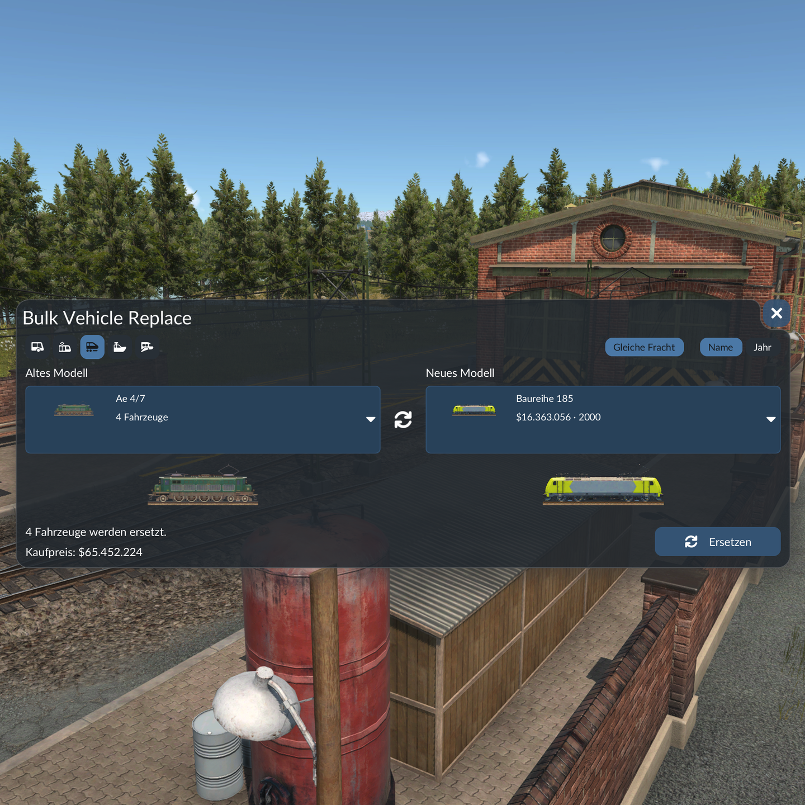

# Bulk Vehicle Replace (Transport Fever 3)

Replaces all vehicles of one model with another, across all lines. Adds a "Replace Vehicles" button to the depot window.

Ersetzt alle Fahrzeuge eines Modells durch ein anderes, auf allen Linien. Fügt im Depotfenster einen Button „Fahrzeuge ersetzen“ hinzu.

## Features

- Lists the models you own (left) and suitable replacements that are currently available (right).
- "Same cargo" filter: only offer models that can carry at least the same cargo as the old one. Can be switched off.
- Locomotives only replace locomotives, wagons only wagons. Multiple units are replaced as a whole.
- Sort by name or year. Cargo icons for every model.
- Uses the game's own replace command: regular purchase price, the game refunds the residual value of the old vehicles.
- English and German.

## Install

Get it from mod.io in the game's mod manager, or copy the folder `fahrzeugtausch_1` into your local mods folder.

I recommend saving your game before using the mod for the first time.

## Repository

- `fahrzeugtausch_1/`: the mod itself (`mod.json`, `strings.json`, `content/gui/`, `_metadata/`).
- `test/`: offline test harness. It mocks the game API and renders the window as a tree to check layout rules and replace logic. Run with `bash test/run.sh` (needs Lua 5.2 and Python 3, paths in `run.sh`).

## License

MIT, see [LICENSE](LICENSE).

Developed with AI assistance (Claude), tested in game by the author.
