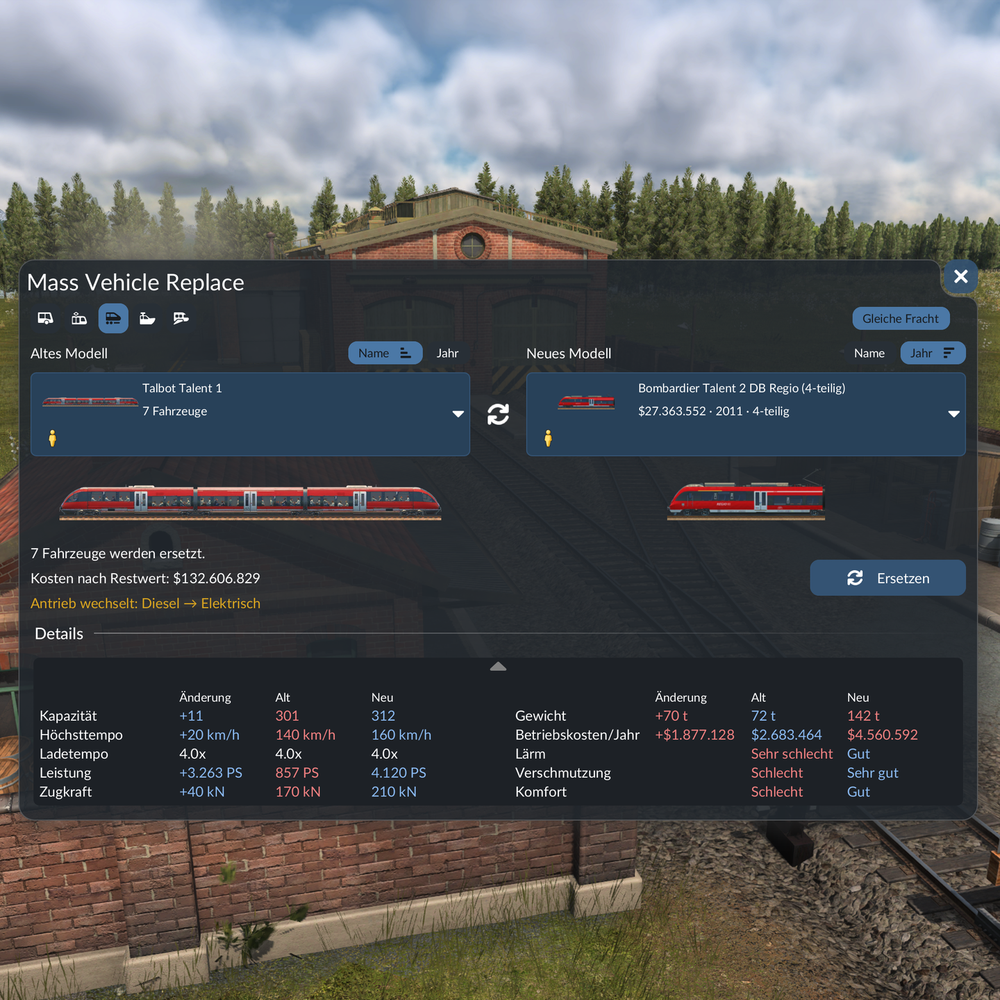

# Mass Vehicle Replace (Transport Fever 3)

Replaces all vehicles of one model with another, across all lines. Adds a "Replace Vehicles" button to the depot window.

## Features

- Lists the models you own (left) and suitable replacements that are currently available (right).
- "Same cargo" filter: only offer models that can carry at least everything the old one could. Can be switched off.
- Locomotives only replace locomotives, wagons only wagons. Multiple units are replaced as complete sets. Reversed vehicles and units stay reversed. In mixed trains only the chosen model is replaced.
- Warns when the engine type changes, e.g. from diesel to electric.
- A "Details" card compares the old and the new model value by value (capacity, speed, power, running costs, noise and more).
- Each list sorts by name or year on its own; a second click reverses the order. Sorting, "Same cargo" and the Details card are kept in the savegame.
- Cargo icons for every model. The color of the old vehicles is kept where possible.
- Uses the game's own replace command. Like the game's purchase window, the cost is the purchase price minus the residual value of the old vehicles; replacing is only possible when the balance covers it. Trains where only some vehicles are replaced are priced like the game's "Modify" window. When the money does not cover all vehicles, a yellow "Replace x of y" button replaces only the oldest ones it covers.
- Orders: tick "Order n" and the vehicles the money does not cover are replaced automatically as money comes in, oldest first. The "Orders" tab lists every order with its open and skipped vehicles and prices, a reserve that stays on the account, "Hold orders" and "Cancel all". Orders are kept in the savegame.
- English and German.

## Install

Get it from mod.io in the game's mod manager, or copy the folder `mass_vehicle_replace_1` into your local mods folder.

I recommend saving your game before using the mod for the first time. The mod only changes the user interface and can be removed at any time. Other mods that change the depot window might conflict with it.

## Repository

- `mass_vehicle_replace_1/`: the mod itself (`mod.json`, `strings.json`, `content/gui/`, `_metadata/`).
- `test/`: offline test harness. It mocks the game API and renders the window as a tree to check layout rules and replace logic. Run with `bash test/run.sh` (needs Lua 5.2 and Python 3, paths in `run.sh`).

## Feedback

Bugs and ideas are welcome as [issues](https://github.com/ramsterhad/tf3-mass-vehicle-replace/issues) or as a comment on the mod's mod.io page, in English or German.

## License

MIT, see [LICENSE](LICENSE).

Developed with AI assistance (Claude), tested in game by the author.
